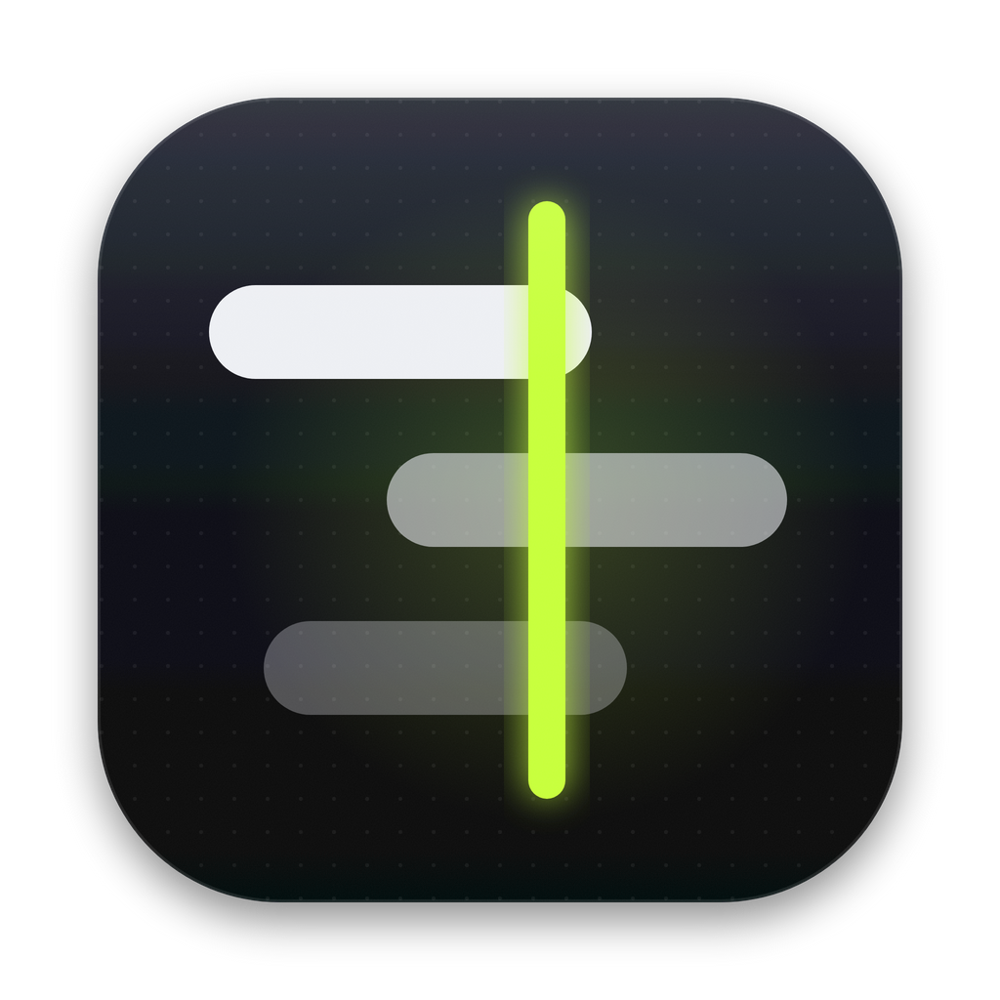

<p align="center">
  
</p>

<h1 align="center">TwitchSync</h1>

<p align="center"><b>Viele Streams. Ein Moment.</b><br/>
Twitch-Multiview für macOS – mehrere Streams gleichzeitig, automatisch zeitlich angeglichen.</p>

---

TwitchSync zeigt beliebig viele Twitch-Streams in einem Grid und gleicht ihre Verzögerung laufend an: Wenn fünf Streamer gemeinsam spielen, siehst du jeden Kill, jede Reaktion und jedes Event in allen Kacheln im selben Moment. Dazu kommen dein eigener Twitch-Login (Turbo, Abo-Werbefreiheit, Sub-Emotes), deine gefolgten Live-Kanäle, Chat mit Tabs und eine automatische Erkennung von Multistreams.

## Funktionen

- **Auto-Sync** – misst bei jedem Stream die Latenz zum Streamer und gleicht alle an den langsamsten an. Schnellere Streams spielen kurz langsamer (Tonhöhe bleibt erhalten) oder halten für exakt die fehlende Zeit an. Haben alle genug Puffer, holt die ganze Gruppe gemeinsam auf, damit die Verzögerung nicht dauerhaft wächst.
- **Manuelle Feinjustierung** pro Stream in ±0,1 s / ±1 s, „Resync“-Button und Live-Anzeige der Latenz in jeder Kachel. Die **Latenz-Schiene** in der Toolbar zeigt alle Streams auf einer Achse – sind sie synchron, laufen die Marker an der grünen Sync-Linie zusammen.
- **Grid** mit offiziellem Twitch-Player, das sich an Anzahl und Fenstergröße anpasst (16:9 maximiert). **Doppelklick = Fokus-Modus** (ein Stream groß, Rest als Leiste), Kacheln per Griff umsortieren.
- **Facecam-Modus** – ein Stream als großes Gameplay-Bild, alle anderen Kanäle daneben nur als **Facecam**. Die Webcam wird automatisch erkannt (Gesichtserkennung über mehrere Frames, auf macOS über Apples Vision-Framework) und passend zugeschnitten. Liegt die Erkennung daneben, ziehst du den Rahmen im Zuschnitt-Editor selbst – das wird pro Kanal gemerkt.
- **Kachel-Infos, die nichts verdecken** – Name, Latenz und Bedienelemente sitzen standardmäßig in einer schmalen Leiste **über** dem Bild. Alternativ als Overlay auf dem Bild, oder mit `I` komplett ausgeblendet (dann auch ohne Twitch-Steuerleiste).
- **Ton per Klick**: Klick auf einen Stream gibt ihm den Ton, die anderen werden stumm. ⌥-Klick mischt weitere Streams dazu. Lautstärke pro Stream.
- **Login wie im Browser** in einem eigenen Twitch-Fenster. Die Sitzung bleibt dauerhaft gespeichert und gilt für alle Player und Chats – Turbo, Abo-Werbefreiheit und Sub-Emotes greifen automatisch.
- **Gefolgte Kanäle**, die gerade live sind, in der Seitenleiste – ein Klick fügt sie hinzu. Ohne Login zeigt „Gerade beliebt“ die Top-Streams deiner Sprache.
- **Chat-Seitenleiste** (Twitch-Popout-Chat) mit Tabs pro Kanal, ein-/ausklappbar, in der Breite ziehbar. Der Chat folgt auf Wunsch dem Stream, den du hörst.
- **Multistream-Erkennung**: Stream Together (Guest Star), Shared Chat und @-Erwähnungen bzw. twitch.tv-Links im Titel. Live-Partner erscheinen als Chip in der Kachel, mit **„Alle öffnen“**.
- **Werbeblocker** für bekannte Werbe- und Tracking-Domains in der Twitch-Sitzung, eigene Domains ergänzbar, plus **entpackte Browser-Erweiterungen** (z. B. uBlock Origin) ladbar. Der Videostream selbst wird nicht verändert.
- Alles wird gemerkt: Kanäle, Reihenfolge, Ton, Fokus, Versätze, Lautstärken, Fenster und Einstellungen.

## Schnellstart

Voraussetzungen: macOS 12 oder neuer, [Node.js](https://nodejs.org) 18+.

```bash
npm install
npm start
```

Kanäle fügst du oben über das Suchfeld hinzu (⌘L) – per Name, `@name`, mehrere auf einmal (`papaplatte trymacs eliasn97`) oder als twitch.tv-Link. Links lassen sich auch einfach aufs Fenster ziehen.

## App bauen

```bash
npm run pack   # baut dist/mac-<arch>/TwitchSync.app (ad-hoc signiert, lokal startbar)
npm run dist   # DMG + ZIP für Apple Silicon und Intel
```

`npm run pack` erzeugt die `.app` für die Architektur deines Macs. Zum Veröffentlichen mit Developer-ID-Signatur und Notarisierung setzt du die üblichen [electron-builder-Variablen](https://www.electron.build/code-signing) (`CSC_LINK`/`CSC_NAME`, `APPLE_ID`, `APPLE_APP_SPECIFIC_PASSWORD`, `APPLE_TEAM_ID`) und führst `npm run dist` aus. Hardened Runtime und Entitlements sind bereits konfiguriert. Ohne Signatur blockiert Gatekeeper die App auf anderen Macs, bis man sie per Rechtsklick → „Öffnen“ freigibt.

## Bedienung

| Aktion | Kürzel |
| --- | --- |
| Kanal hinzufügen | ⌘L |
| Ton auf Stream 1–9 | ⌘1 … ⌘9 oder 1 … 9 |
| Stream zum Ton-Mix hinzufügen | ⌥-Klick |
| Fokus-Modus | Doppelklick · ⌘↩ · F |
| Facecam-Modus | ⇧⌘F · C (Doppelklick auf Facecam = Hauptbild) |
| Zurück zum Grid | Esc · G |
| Kachel-Infos ein/aus | ⇧⌘I · I |
| Alle stummschalten | ⇧⌘M · M |
| Lautstärke des aktiven Streams | ↑ ↓ · ⌥ + Scrollen |
| Auto-Sync an/aus | ⇧⌘S |
| Alle neu synchronisieren | ⇧⌘R |
| Streams neu laden | ⌘R |
| Kanäle-Leiste / Chat | ⌘B / ⇧⌘C |
| Einstellungen | ⌘, |

Jede Kachel hat eine Info-Leiste über dem Bild: Kanal, Kategorie, Zuschauer, Multistream-Partner und Latenz. Beim Überfahren erscheinen die Aktionen (Umsortieren, Ton, Fokus, Chat, Qualität, Entfernen). Ein Klick auf die Latenz öffnet das Sync-Panel mit Versatz-Tasten (±0,1 s / ±1 s), Resync und Lautstärke. Im Overlay-Stil liegt dasselbe als schwebendes Dock auf dem Bild. Die Steuerleiste des Twitch-Players (Qualität, Untertitel …) bleibt erreichbar.

### Facecam-Modus

Über den Ansichts-Umschalter in der Toolbar (oder `C`) wird der Stream mit Ton zum Hauptbild, alle anderen schrumpfen auf ihre Webcam. TwitchSync nimmt dafür fünf Standbilder pro Stream, sucht Gesichter und wählt das, das an derselben Stelle immer wieder auftaucht – Gesichter im Gameplay springen herum, die Facecam nicht. Daraus entsteht ein 4:3-Ausschnitt mit Kopf und Schultern. Automatische Ausschnitte werden alle drei Minuten überprüft, manuelle bleiben fest. Doppelklick auf eine Facecam macht sie zum Hauptbild.

## Wie der Sync funktioniert

Vor der Umsetzung wurde geprüft, was der eingebettete Twitch-Player und das `<video>`-Element öffentlich anbieten:

| Schnittstelle | Ergebnis |
| --- | --- |
| Embed-API `getPlaybackStats()` | Liefert `hlsLatencyBroadcaster` (Latenz zum Streamer). Der Player sendet seinen Zustand als `UPDATE_STATE`-Nachricht – läuft er direkt in einem `<webview>`, schickt er sie an sich selbst, TwitchSync liest sie mit. |
| Embed-API-Befehle (`play`, `pause`, `setVolume`, `setQuality`) | Werden ignoriert, solange der Player nicht in einem echten Eltern-Frame steckt. Einen Tempo-Befehl gibt es ohnehin nicht. |
| `HTMLMediaElement.playbackRate` | Funktioniert, aber der Player setzt fremde Werte sofort zurück. |
| `HTMLMediaElement.pause()` | Der Player verwirft beim Pausieren den Puffer und springt beim Fortsetzen zurück an die Live-Kante – Pausieren erhöht die Latenz also **nicht**. |

Daraus folgt der Aufbau:

1. **Messen** – Aus `hlsLatencyBroadcaster` und der Wiedergabeposition wird der Versatz zwischen Sendezeit und Videozeit gebildet (Median über mehrere Messungen). Damit ist die Latenz jederzeit glatt ableitbar, nicht nur alle zwei Sekunden.
2. **Steuern** – Ein kleiner Hook im Player setzt `playbackRate` am `<video>`-Element und meldet dem Player weiterhin seinen eigenen Wert, damit er nicht gegensteuert. Statt `pause()` wird mit Rate 0 „eingefroren“; die Dauer wird im Player selbst getimt und ist damit millisekundengenau.
3. **Regeln** – Ziel ist die höchste Latenz aller Streams (inklusive deines manuellen Versatzes). Kleine Abstände werden durch Verlangsamen (bis 0,9×, einstellbar) geschlossen, große durch Anhalten. Mit „Latenz minimieren“ beschleunigt die ganze Gruppe gemeinsam (bis 1,08×), sobald jeder Stream genügend Puffer hat.
4. **Low-Latency-Modus** des Players ist für alle Streams deaktiviert – der normale Modus puffert stabiler.

Streams in Werbepausen, offline oder beim Nachladen werden vorübergehend aus der Angleichung genommen.

## Multistream-Erkennung

Für jeden Kanal im Grid fragt TwitchSync jede Minute über Twitchs GraphQL-Schnittstelle ab:

- `sharedChatSession(channelID)` → `participants { channel { id name displayName } }`
- `user.channel.guestStarSessionCall` → Host und Gäste einer Stream-Together-Session
- @-Erwähnungen und `twitch.tv/…`-Links im Streamtitel

Davon werden nur Kanäle angezeigt, die gerade live sind und noch nicht im Grid laufen.

## Werbeblocker und Erweiterungen

Der eingebaute Blocker sperrt Anfragen an bekannte Werbe-, Analyse- und Tracking-Hosts (Google Ads, Amazon Ads, Comscore, Exchanges …) innerhalb der Twitch-Sitzung. Twitchs eigene Telemetrie lässt sich optional blockieren – das stoppt allerdings auch den Drops-Fortschritt. Der Videostream wird bewusst nicht angefasst; werbefrei schaust du über Turbo oder Abos.

Unter *Einstellungen → Werbeblocker* kannst du einen entpackten Erweiterungsordner laden (z. B. das „chromium“-Release von uBlock Origin entpacken). Electron unterstützt nur einen Teil der Chrome-Extension-APIs, Content-Scripts und Regeln funktionieren aber.

## Daten und Datenschutz

- Einstellungen: `~/Library/Application Support/TwitchSync/settings.json`
- Twitch-Sitzung (Cookies, Player-Einstellungen): im selben Ordner unter `Partitions/twitch`
- Dein Passwort gibst du direkt bei twitch.tv ein; TwitchSync liest nur das Sitzungs-Cookie, um deine gefolgten Kanäle abzufragen.
- Keine eigene Telemetrie, keine Server. Netzwerkverkehr geht ausschließlich an Twitch (und an das, was der Twitch-Player selbst lädt).
- „Abmelden“ löscht die Twitch-Cookies und den Speicher der Twitch-Seiten.

## Bekannte Einschränkungen

- **Twitch-Werbung**: Für Kanäle ohne Abo (und ohne Turbo) kann Twitch weiterhin Werbung einblenden. Während einer Werbepause wird der Stream nicht synchronisiert und danach wieder angeglichen.
- **Cookie-Hinweis**: Twitch zeigt in der EU beim ersten Laden einen Einwilligungsdialog (im Chat bzw. im Login-Fenster). Die Auswahl triffst du selbst; sie wird in der Sitzung gespeichert.
- **Inoffizielle Schnittstellen**: Gefolgte Kanäle, Suche und Multistream-Erkennung nutzen Twitchs Web-GraphQL-Schnittstelle. Ändert Twitch sie, kann eine dieser Funktionen ausfallen, ohne dass Wiedergabe und Sync betroffen sind.
- **Kleine Kacheln**: Twitch spielt eingebettete Player unter 400×300 px nicht automatisch ab. Kleinere Kacheln rendern den Player deshalb in Mindestgröße und skalieren ihn herunter.
- **Facecam-Erkennung** braucht ein sichtbares Gesicht. Streamer ohne Kamera, mit Maske oder VTuber-Avatar werden nicht erkannt – dann den Ausschnitt einmal von Hand setzen.
- **Gleichzeitige Streams**: Maximal 16. Ab etwa 9 Streams lohnt sich eine niedrigere Standardqualität (Einstellungen → Wiedergabe).

## Entwicklung

```bash
npm start                                   # App starten (Entwicklerwerkzeuge im Menü „Ansicht“)
TWITCHSYNC_USER_DATA=/tmp/ts-profile npm start   # separates Profil, echte Sitzung bleibt unberührt
npm run lint                                # Syntax-Check aller Quellen
npm run icon                                # build/icon.svg → icon.png + icon.icns
```

Kein Build-Schritt: Main-Prozess in CommonJS, Oberfläche als native ES-Module, Schriften liegen lokal im Projekt.

```
src/
  main/        Fenster, Menü, Einstellungen, Twitch-Sitzung, GraphQL, Werbeblocker
  preload/     app-preload (API für die Oberfläche), player-preload (Latenz & Tempo), chat-preload
  renderer/    Oberfläche: Grid, Kacheln, Sync-Regler, Facecam-Zuschnitt, Chat, Seitenleiste, Einstellungen
build/         App-Icon (SVG-Quelle), Entitlements
scripts/       Icon-Generator, Syntax-Check
```

## Rechtliches

TwitchSync ist ein inoffizielles Projekt und steht in keiner Verbindung zu Twitch Interactive, Inc. „Twitch“ ist eine Marke von Twitch Interactive, Inc. Streams werden ausschließlich über den offiziellen eingebetteten Twitch-Player abgespielt. Wer die App öffentlich verteilt, sollte die [Markenrichtlinien von Twitch](https://brand.twitch.tv) prüfen – je nach Nutzung kann ein Name ohne „Twitch“ sinnvoller sein.

Schriften: Bricolage Grotesque, Instrument Sans und Martian Mono unter der SIL Open Font License (siehe `src/renderer/assets/fonts/OFL.txt`).

## Lizenz

[MIT](LICENSE) © 2026 olivrr-vfx
